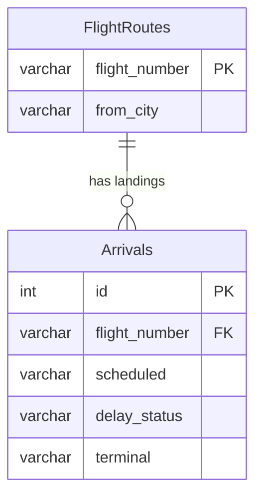

# Flight Arrivals Management System (JDBC_FlightManager)

**Course:** Software Engineering Methods (2026–2027)  
**Institution:** Braude College of Engineering  
**Language:** Java 25 LTS  
**Database:** MySQL 8.0+

---

## 1. Project Description

This project implements a Java JDBC Data Access Layer (DAL) for an airport flight arrivals management system.

The application imports 299 flight records from a CSV file into a MySQL database named `FlightDB`.

The original `rawflights` table was normalized into two related tables: `FlightRoutes` and `Arrivals`.

The application supports:

- Displaying all flights using an INNER JOIN.
- Updating the status of a selected flight.
- Updating multiple arrivals using batch processing.
- Filtering flights by terminal and scheduled arrival time.
- Demonstrating and fixing an SQL Injection vulnerability.

## 2. Engineering Team Details

| Role | Full Name | Student ID | Academic Email |
|---|---|---|---|
| Student A | [Mohammad Diab] | [325555217] | [Mohamed.Diab2@e.braude.ac.il] |
| Student B | [Mohammad Nawatha] | [325218477] | [Mohammad.Nawatha@e.braude.ac.il] |

**Group Number:** G[XX]

**GitHub Repository:** [https://github.com/MohammadNawatha/JDBC_FlightManager.git]

The exercise was designed around a single-workstation Driver–Navigator workflow, with role changes during development.

## 3. Technology Stack

- **Programming Language:** Java 25 LTS
- **Java Development Kit:** BellSoft Liberica Full JDK 25 LTS
- **Database:** MySQL Server 8.0+
- **JDBC Driver:** MySQL Connector/J 9.5.0
- **Development Environment:** IntelliJ IDEA Ultimate
- **Database Management:** IntelliJ Database Tool Window and Query Console
- **Version Control:** Git and GitHub
- **AI Assistance:** ChatGPT was used to generate, review, explain, and troubleshoot Java and SQL code. Continue was used earlier to generate the initial 3NF database migration script. Subsequent Java implementations and the SQL Injection security refactoring were completed manually using code provided through ChatGPT.

## 4. Database Normalization (3NF) and Functional Dependencies

### 4.1 Functional Dependencies

The original table contained the following columns:

`rawflights(scheduled, flight, fromC, delay, terminal)`

The important functional dependency is:

`flight → fromC`

This means a flight number determines its departure city.

### 4.2 Why the Original Table Violated 3NF

The original table repeatedly stored departure-city information for multiple arrival events associated with the same flight.

This redundancy could cause:

- **Update anomalies:** Changing a flight's departure city might require modifying multiple records.
- **Insertion anomalies:** Route information could not easily be stored independently of an arrival.
- **Deletion anomalies:** Removing the last arrival could also remove information about its route.

Normalization separates route information from individual arrival events, reducing redundancy and avoiding these anomalies.

### 4.3 Normalized Database Schema

**FlightRoutes**

- `flight_number VARCHAR(50)` — Primary Key
- `from_city VARCHAR(100)` — Not Null

**Arrivals**

- `id INT AUTO_INCREMENT` — Primary Key
- `flight_number VARCHAR(50)` — Foreign Key
- `scheduled VARCHAR(50)`
- `delay_status VARCHAR(50)`
- `terminal VARCHAR(10)`

The `Arrivals.flight_number` foreign key references `FlightRoutes.flight_number`, with `ON DELETE CASCADE`.

The normalized database contains 299 arrival records.

## 5. FlightViewer Implementation (Part 4)

### 5.1 Development Approach

The `FlightViewer.java` class was implemented manually in IntelliJ IDEA using Java code generated with assistance from ChatGPT.

The class was not generated through the Continue plugin. Therefore, no independently authored Continue prompt was submitted for this implementation.

This approach satisfies the functional programming requirements but differs from the exercise's prescribed Continue-based prompting workflow.

### 5.2 Functional Requirements Implemented

The `FlightViewer` application:

1. Connects to the `FlightDB` MySQL database using JDBC.
2. Requests the MySQL root password through `Scanner`.
3. Requests a terminal number from the user (2, 3, 4, or 5).
4. Retrieves arrival information using an `INNER JOIN` between `Arrivals` and `FlightRoutes`.
5. Uses a secure `PreparedStatement` with a parameterized terminal filter.
6. Binds the terminal using `pstmt.setString(1, terminal)`.
7. Sorts results using `ORDER BY a.scheduled ASC`.
8. Displays the matching flights in a formatted console table.

### 5.3 SQL Query

The application uses the following query:

```sql
SELECT a.flight_number,
       r.from_city,
       a.scheduled,
       a.delay_status,
       a.terminal
FROM Arrivals a
INNER JOIN FlightRoutes r
    ON a.flight_number = r.flight_number
WHERE a.terminal = ?
ORDER BY a.scheduled ASC;
```

The `?` placeholder ensures that the user's terminal selection is treated as data rather than executable SQL.

## 6. Entity Relationship Diagram (ERD)



The relationship between the tables is one-to-many: each flight route can be associated with multiple arrival records.

## 7. Security Audit Summary

### 7.1 SQL Injection Vulnerability

The initial implementation of `SimpleFlightUpdater.java` used a standard `Statement` and constructed SQL queries by concatenating user input.

This approach allowed user-supplied characters to modify the structure of the SQL statement.

### 7.2 Attack Demonstration

The following input was tested:

`Landed' #`

The single quote closed the SQL string, and the `#` character started a MySQL comment.

Consequently, the `WHERE` condition was ignored and all 299 arrival records were updated.

### 7.3 Security Refactoring

The vulnerable implementation was replaced with a secure `PreparedStatement` using parameterized queries.

The updated SQL statement is:

```sql
UPDATE Arrivals
SET delay_status = ?
WHERE flight_number = ?;
```

The application binds the values using `setString()`, preventing user input from changing the SQL command structure.

### 7.4 Verification Results

After the security fix:

- The identical attack input was tested again.
- Only flight `LX354` was updated.
- The other 298 arrival records remained unchanged.
- The input `Landed' #` was treated as a literal string.

The security test confirmed that the parameterized implementation prevented this SQL Injection technique.

## 8. License

Distributed under the **Braude College Academic License** (Software Engineering Methods, 2026–2027).